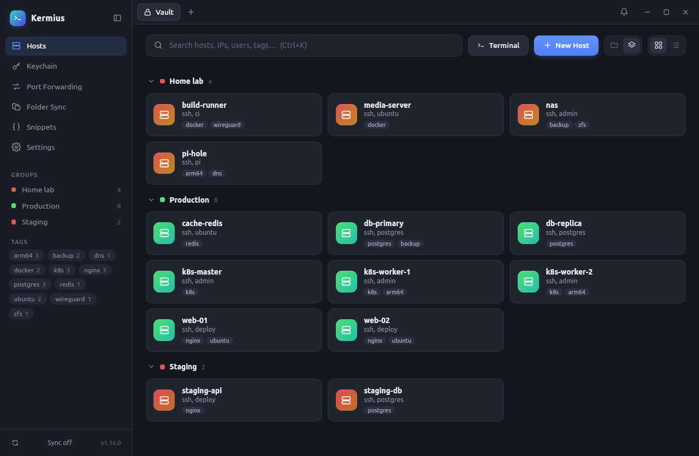
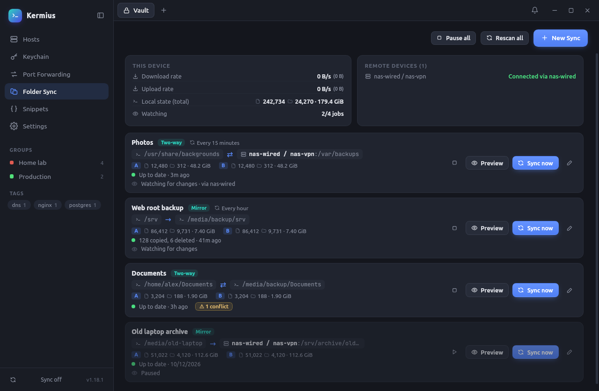
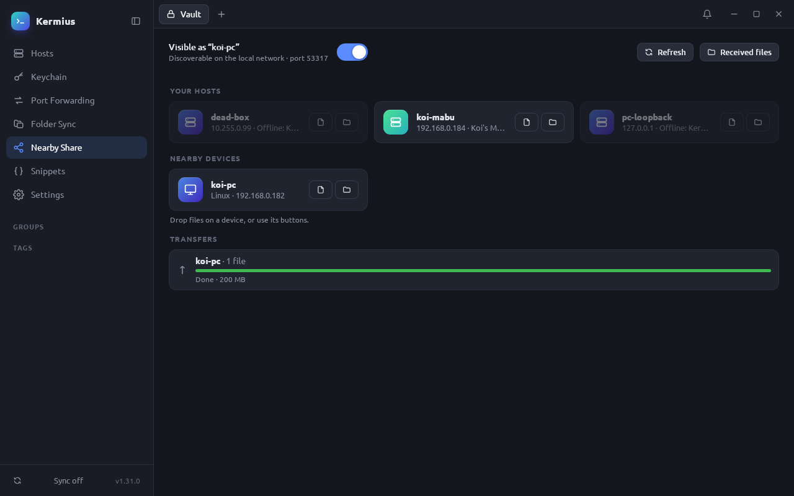

# Kermius

A fast, Termius-style SSH client built with Tauri 2 (Rust + TypeScript), with self-hosted, end-to-end encrypted sync.



- Hosts organised by **groups** (folders) and **tags**, instant search (`Ctrl+K`)
- Multi-tab SSH terminals (xterm.js + WebGL), password / private key / keyboard-interactive auth
- **Mosh**, **Telnet** (auto-login), **serial** consoles and **VNC** remote desktops (noVNC) in tabs
- **Copy password** from host cards, the right-click menu, the editor, or the terminal toolbar
- Local port forwarding rules per host
- Jump hosts, SOCKS5/HTTP proxies, agent forwarding, environment variables and a startup snippet per host
- **Nearby Share** (desktop): send and receive files on the local network, compatible with the [LocalSend](https://localsend.org) apps
- Trust-on-first-use host key checking (synced across devices)
- Local vault encrypted at rest (XChaCha20-Poly1305)
- Sync to your own server; data is encrypted on-device with Argon2id(passphrase) — the server only sees ciphertext

## Develop

```sh
npm install
npx tauri dev
```

## Build

```sh
npx tauri build              # desktop bundles for the current OS
npx tauri android build      # needs Android SDK + NDK
npx tauri ios build          # needs macOS + Xcode
```

`.github/workflows/build.yml` builds Linux (x64 + arm64 / Raspberry Pi), Windows, macOS (universal), Android (APK) and iOS (when `APPLE_DEVELOPMENT_TEAM` is set), plus the sync server image.

## Import from Termix

Export hosts in Termix (JSON), then either use **Settings → Import from Termix**, or:

```sh
kermius --import-termix ~/termix-hosts.json
```

Groups, tags, passwords, keys, notes and local port-forward rules are kept. Re-importing updates hosts instead of duplicating them.

## Sync server

```sh
cd server
cp .env.example .env
sed -i "s/^KERMIUS_TOKEN=.*/KERMIUS_TOKEN=$(openssl rand -hex 32)/" .env
docker compose up -d   # pulls hienanh/kermius-sync, listens on port 8080 (change KERMIUS_PORT in .env)
```

Put it behind HTTPS (Caddy, Traefik, nginx…). In Kermius → Settings → Sync, enter the server URL, the token and an encryption passphrase. Use the same passphrase on every device; it never leaves the device and lost passphrases cannot be recovered.

API: `GET /v1/vault` → blob + `x-version`; `PUT /v1/vault` with `x-base-version` (409 on conflict; the client re-pulls and merges per host by last update).

## Mosh, serial and VNC

- **Mosh** needs `mosh` on this computer (the .deb/.rpm installs it; macOS: `brew install mosh`) and `mosh-server` on the host, with UDP ports 60000–61000 open. The host editor has a copyable install command. Kermius signs in over SSH with the host's stored credentials.
- **Serial** on Linux needs the `dialout` group: `sudo usermod -aG dialout $USER`, then log out and back in.
- **VNC** needs nothing extra; the VNC password is the host's password.

## Folder Sync

Two-way sync or one-way mirror between local disks and SSH hosts, with change watching, schedules, multiple routes per device and conflict resolution.



### Requirements

Folder Sync (two-way sync / mirror between disks or with SSH hosts) uses rsync. Linux and macOS only.

**This computer** needs rsync 3.1+:

| OS | Command |
| --- | --- |
| Debian / Ubuntu | `sudo apt install rsync` |
| Fedora / RHEL | `sudo dnf install rsync` |
| Arch | `sudo pacman -S rsync` |
| macOS | `brew install rsync` (the bundled rsync/openrsync is too old) |

**Remote hosts** (Linux) need rsync and GNU find; **inotify-tools** makes remote changes sync instantly (otherwise Kermius checks every minute). Nothing else is installed on the remote.

| OS | Command |
| --- | --- |
| Debian / Ubuntu / Raspberry Pi OS | `sudo apt install -y rsync inotify-tools` |
| Fedora / RHEL / Rocky | `sudo dnf install -y rsync inotify-tools` |
| Arch / Manjaro | `sudo pacman -S --needed rsync inotify-tools` |
| Alpine | `sudo apk add rsync inotify-tools findutils` |
| openSUSE | `sudo zypper install -y rsync inotify-tools` |

Watching only runs while Kermius is open. On Linux, very large trees may hit the inotify watch limit; raise it with `echo fs.inotify.max_user_watches=1048576 | sudo tee /etc/sysctl.d/99-zz-inotify.conf && sudo sysctl -p /etc/sysctl.d/99-zz-inotify.conf` (the `99-zz-` name makes it win over a lower value in `/etc/sysctl.conf`).

## Nearby Share



Send and receive files on the local network (desktop). It speaks the [LocalSend](https://localsend.org) v2 protocol, so it works with the LocalSend apps on phones and computers as well as other Kermius devices. Incoming files need your approval and go to the Downloads folder.

Devices find each other by UDP multicast, which does not cross VPNs or routers. For those, tick **Use this address for Nearby Share** on a host: it appears under *Your hosts* and is reached directly at its address (greyed out while Kermius / LocalSend is not running there). The setting syncs with your hosts.

## Keyboard shortcuts

| Keys | Action |
| --- | --- |
| `Ctrl+K` (`Ctrl+Shift+K` in a terminal) | Search hosts |
| `Ctrl+T` (`Ctrl+Shift+T` in a terminal) | Vault tab |
| `Ctrl+Shift+W` | Close terminal tab |
| `Ctrl+Tab` / `Ctrl+1…9` | Switch tabs |
| `Ctrl+Shift+C` / `Ctrl+Shift+V` | Copy / paste in terminal |
| `Ctrl+S` / `Esc` | Save / close host editor |

## License

[MIT](LICENSE)
